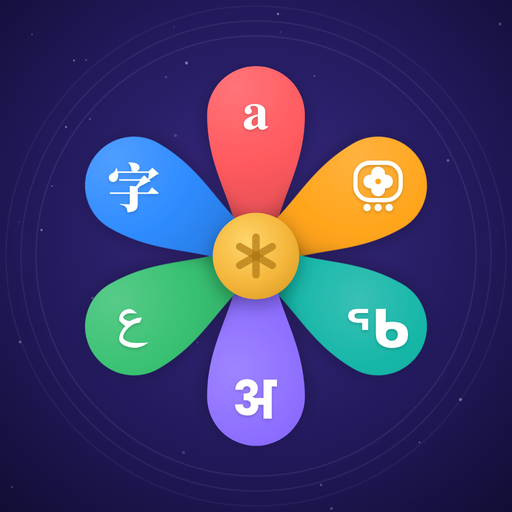
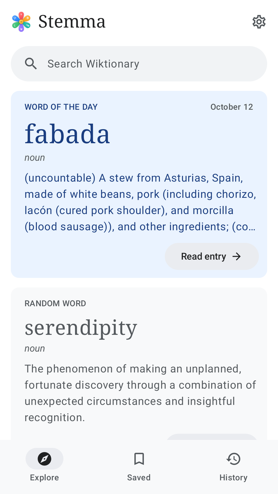
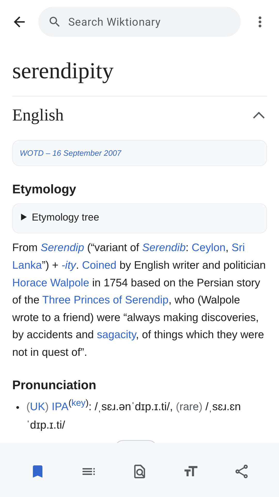
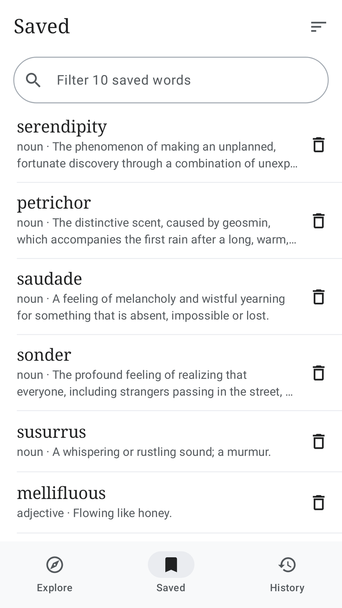
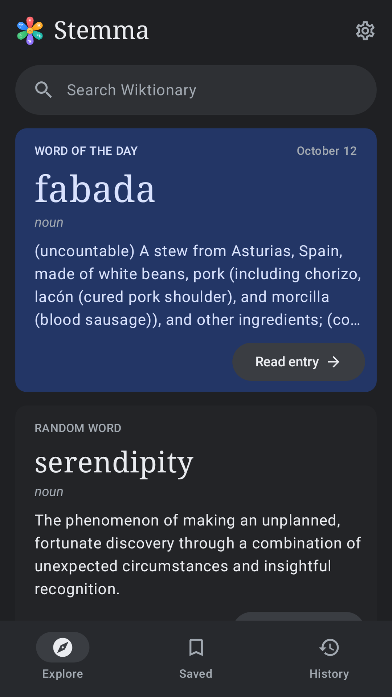

<p align="center"></p>

<h1 align="center">Stemma</h1>

<p align="center">An Android reader for Wiktionary: where every word comes from, in every language.</p>

<p align="center">
  
  
  
  
</p>

Stemma shows entries from [English Wiktionary](https://en.wiktionary.org/), the free dictionary written by volunteers, in a layout made for phones. Wiktionary traces words back through their etymologies to reconstructed proto-languages, and it has entries for words in thousands of languages. The app's layout follows the Wikipedia app.

A stemma is a family tree of descent. The asterisk at the centre of the icon is the mark linguists put before a reconstructed word, such as *wódr̥, the ancestor of "water". The six petals carry letters from six scripts: Latin, Maya, Canadian Aboriginal Syllabics, Devanagari, Arabic and Chinese.

## Features

- Search with suggestions as you type
- Full entries: definitions, examples, pronunciations with audio, etymologies, translations and inflection tables
- One collapsible section per language, with your preferred language opening first
- A Word of the Day and a random word on the Explore screen
- Saved words, readable without an internet connection
- Reading history and recent searches, kept on the device
- Contents, find in page, adjustable text size, and Light, Sepia, Dark and Black themes
- "Define" in other apps' text-selection menus
- No ads, no account and no analytics

## Installing

Stemma is not on Google Play. To install it on an Android phone running Android 8.0 or later:

1. On the phone, download `Stemma-1.0.0.apk` from the [latest release](https://github.com/ML-Chen/stemma/releases/latest).
2. Open the downloaded file. Android asks once for permission to install apps from your browser or file manager; allow it.

You can also build the app yourself, as described below.

## How it works

- Entries come from Wiktionary's `page/mobile-html` REST endpoint, the same endpoint the Wikipedia app reads articles from. `EntryProcessor.kt` rewrites that HTML once: language sections become collapsible blocks, quotations and translation tables are collapsed, and audio players become play buttons. A WebView then shows the result with a local stylesheet and script (`app/src/main/assets/entry/`).
- Search uses `rest.php/v1/search`. The Word of the Day is read from the `Wiktionary:Word of the day` page. Random words come from `Special:RandomInCategory/<Language>_lemmas`.
- To open pages quickly, the app downloads likely next words in advance (a fully typed search term, the Word of the Day and the random word), and shares one download between everything waiting for the same word. It also keeps entries viewed in the last three days on the device.
- Saved words, history and recent searches are kept in one JSON file on the device, and each saved word keeps a full copy of its entry for offline reading.
- Kotlin, Jetpack Compose, Material 3, OkHttp and jsoup. Minimum Android 8.0 (API 26), target API 36, compiled against API 37.

## Building

You need JDK 17 or newer and the Android SDK; Android Studio installs both. Open the folder in Android Studio, or use the command line:

```
./gradlew testDebugUnitTest   # unit tests, and full-app tests that run under Robolectric
./gradlew assembleDebug       # debug APK for a phone or emulator
```

### Signed release builds

Release builds are signed with a key that is not in this repository. To make your own, create a keystore:

```
mkdir -p signing
keytool -genkeypair -keystore signing/upload-keystore.jks -storetype PKCS12 \
  -keyalg RSA -keysize 4096 -validity 10000 -alias upload
```

and a `keystore.properties` file in the project root:

```
storeFile=signing/upload-keystore.jks
storePassword=<your password>
keyAlias=upload
keyPassword=<your password>
```

Then `./gradlew assembleRelease` builds a signed APK and `./gradlew bundleRelease` builds a signed bundle for Google Play. `.gitignore` keeps both files out of version control.

## Publishing on Google Play

`store/` has what a Play listing needs: the 512 px icon, the feature graphic, phone screenshots, a privacy policy page to host, and `store/LISTING.md` with the listing text and answers to Play Console's questions. Change `applicationId` in `app/build.gradle.kts` to your own before the first upload, because Play never allows changing it afterwards. Change `android:targetPackage` in both `shortcuts.xml` files to match.

## Regenerating the icon and screenshots

- The icon is drawn in SVG by `store/tools/logo/` (letters are converted to outlines from installed fonts). Run `python3 store/tools/logo/final.py <chrome binary>` to rebuild the launcher icon layers and `store/icon-512.png`.
- `./gradlew testDebugUnitTest -Pscreenshots` records the app's screens. Then `python3 store/tools/make_store_assets.py <chrome binary>` builds the store screenshots and the feature graphic.
- Both scripts need `pip install playwright fonttools pillow` and a Chrome or Chromium binary.

## Wikimedia API etiquette

The app identifies itself to Wikimedia with a User-Agent containing this repository's address, as Wikimedia's [User-Agent policy](https://foundation.wikimedia.org/wiki/Policy:User-Agent_policy) asks. Wikimedia rate-limits anonymous API traffic per IP address. One person using the app stays far below those limits, and the app shows a "Wiktionary is busy" message if a limit is ever hit.

## Licence and credits

- Stemma's code, icon and store graphics are released under the [MIT License](LICENSE).
- Dictionary content shown in the app, and the saved responses in `app/src/test/resources/samples/`, come from Wiktionary and are available under the [Creative Commons Attribution-ShareAlike 4.0 License](https://creativecommons.org/licenses/by-sa/4.0/). Every entry in the app links to its source page and list of contributors.
- Libraries: AndroidX, Jetpack Compose, Kotlin, kotlinx.coroutines, kotlinx.serialization and OkHttp (Apache License 2.0); jsoup (MIT License).
- Stemma is an independent app. It is not made, endorsed or sponsored by the Wikimedia Foundation. Wiktionary is a trademark of the Wikimedia Foundation.
